# Database design (ERD)

MySQL 8, InnoDB, `utf8mb4`. The runnable schema is [`database/schema.sql`](../database/schema.sql).

**Main entities:** `users`, `residents`, `resident_relatives`, plus the resident's records: `allergies`, `health_conditions`, `medications`, `vital_signs`, `care_notes`, `schedules`, `weekly_summaries`.
**Workflow and technical tables:** `deletion_requests`, `account_invites`, `audit_logs`.

```mermaid
erDiagram
    users ||--o{ resident_relatives : "is relative in"
    residents ||--o{ resident_relatives : "has relatives"
    users ||--o{ account_invites : "receives"

    residents ||--o{ allergies : has
    residents ||--o{ health_conditions : has
    residents ||--o{ medications : takes
    residents ||--o{ vital_signs : "measured"
    residents ||--o{ care_notes : "noted"
    residents ||--o{ schedules : "scheduled"
    residents ||--o{ weekly_summaries : "summarised"
    residents ||--o{ deletion_requests : "archive requested"

    users ||--o{ deletion_requests : "requests / reviews"
    users ||--o{ care_notes : writes
    users ||--o{ vital_signs : records
    users ||--o{ audit_logs : "acts"

    users {
        int id PK
        varchar full_name
        varchar email UK
        varchar phone
        varchar password_hash "NULL until activated"
        enum role "admin | operator | relative"
        enum status "invited | active | disabled"
        datetime last_login_at
        datetime created_at
        datetime updated_at
    }
    account_invites {
        int id PK
        int user_id FK
        char token_hash UK "SHA-256, raw token never stored"
        datetime expires_at
        datetime used_at
        int created_by FK
        datetime created_at
    }
    residents {
        int id PK
        varchar resident_code UK
        varchar full_name
        date date_of_birth
        enum gender
        varchar photo_url
        varchar room
        date admission_date
        enum status "active | hospital | discharged | deceased | archived"
        enum mobility_level
        enum fall_risk "low | medium | high"
        varchar diet_notes
        varchar cognitive_status
        varchar primary_doctor
        varchar preferred_hospital
        datetime archived_at
        int created_by FK
        datetime created_at
        datetime updated_at
    }
    resident_relatives {
        int id PK
        int resident_id FK
        int relative_user_id FK
        varchar relationship
        enum access_level "full | basic"
        bool is_emergency_contact
        bool is_legal_guardian
        datetime consent_recorded_at
        int consent_recorded_by FK
        varchar consent_note
        bool active
        datetime created_at
    }
    allergies {
        int id PK
        int resident_id FK
        varchar allergen
        enum type "drug | food | other"
        varchar reaction
        enum severity "mild | moderate | severe"
    }
    health_conditions {
        int id PK
        int resident_id FK
        varchar name
        date since_date
        varchar notes
    }
    medications {
        int id PK
        int resident_id FK
        varchar name
        varchar dosage
        enum route
        json times_of_day "e.g. [08:00, 20:00]"
        varchar instructions
        date start_date
        date end_date
        varchar prescribed_by
        bool active
    }
    vital_signs {
        int id PK
        int resident_id FK
        datetime measured_at
        smallint bp_systolic
        smallint bp_diastolic
        smallint pulse
        decimal temperature_c
        tinyint spo2
        decimal weight_kg
        decimal blood_sugar_mmol
        int recorded_by FK
    }
    care_notes {
        int id PK
        int resident_id FK
        enum category "daily | health | incident | activity"
        text note
        bool visible_to_family
        int author_id FK
        datetime created_at
    }
    schedules {
        int id PK
        int resident_id FK
        varchar title
        enum type "activity | appointment | therapy | visit"
        datetime start_at
        datetime end_at
        varchar location
        varchar notes
    }
    weekly_summaries {
        int id PK
        int resident_id FK
        date week_start
        text content
        enum source "ai | staff"
        datetime published_at
        int published_by FK
    }
    deletion_requests {
        int id PK
        int resident_id FK
        int requested_by FK
        varchar reason
        enum status "pending | approved | rejected | cancelled"
        int reviewed_by FK
        varchar review_note
        datetime created_at
        datetime reviewed_at
    }
    audit_logs {
        bigint id PK
        int actor_user_id FK
        varchar action
        varchar entity_type
        int entity_id
        json before_data
        json after_data
        varchar ip_address
        datetime created_at
    }
```

## Design notes

- **One `users` table for all roles.** Staff and relatives log in the same way, and `role` decides what they can do. Three roles are fixed, so an enum is simpler than a `roles` table.
- **`resident_relatives` is the access-control table.** It is many-to-many: a resident can have several relatives, and one relative can have several family members at the center. `UNIQUE (resident_id, relative_user_id)` prevents duplicate links. Unlinking sets `active = 0`, which keeps the consent history.
- **No redundancy.** Relative contact details live only in `users`. The relationship and consent live only on the link. Resident sub-records reference `residents.id` and never copy the resident's name.
- **Soft delete.** Residents are archived (`status = 'archived'`, `archived_at`) and never deleted, so every child table keeps its history. Foreign keys to `residents` use `ON DELETE RESTRICT` to block accidental hard deletes.
- **Approvals.** `deletion_requests` keeps every request, including rejected ones. A rule in the service layer allows at most one `pending` request per resident and stops the requester from reviewing their own request.
- **Invites.** Only a SHA-256 hash of the activation token is stored, so a leaked database can't be used to activate accounts.
- **Audit log** is insert-only from the app. `before_data`/`after_data` store changed fields for record edits. Log text never contains health details.
- **Medication times** are a small JSON array because they're always read and written together with the medication. A per-dose `medication_logs` table is a stretch goal.
